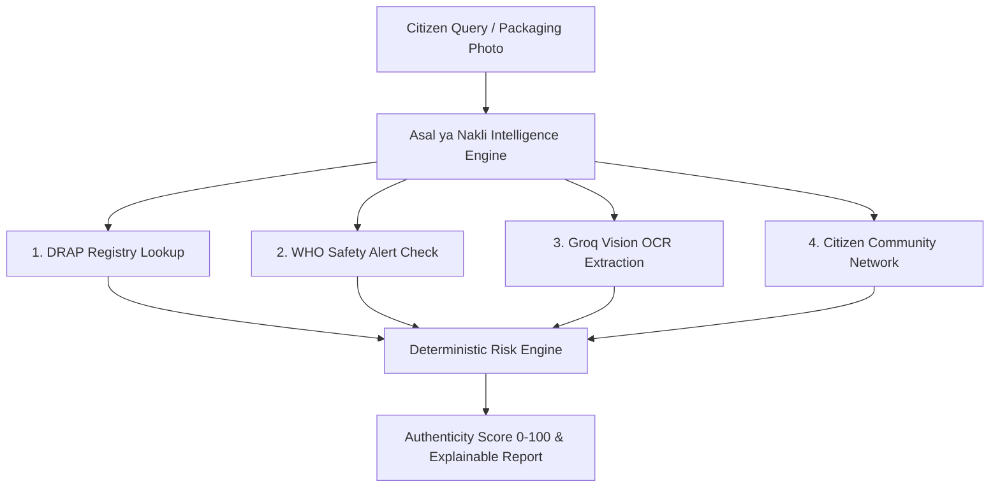

# Asal ya Nakli? (اصل یا نقلی؟)
> **Evidence-Based Product Authenticity & Medicine Intelligence Platform**

[](https://asal-ya-nakli.web.app)
[](https://github.com/HamzaKhanBUIC/asal-ya-nakli)
[](https://nextjs.org/)
[](https://groq.com/)
[](https://supabase.com/)

---

## 🚨 The Challenge

Falsified, counterfeit, and substandard pharmaceuticals pose a grave public safety hazard in Pakistan and developing markets across South Asia. According to global health estimates:

- **1 in 10** medical products in low- and middle-income countries is either substandard or falsified.
- Citizens lack a rapid, evidence-grounded tool to cross-reference medicine packaging against official regulatory databases before consumption.
- Public safety warnings issued by regulatory bodies often remain trapped in PDF circulars, unindexed and inaccessible to everyday consumers at the pharmacy counter.

**Asal ya Nakli? (اصل یا نقلی？)** solves this by putting an **automated authenticity intelligence engine** into the hands of every citizen.

---

## 🛡️ The Solution

**Asal ya Nakli** is an open, evidence-grounded verification system that evaluates medicine authenticity in seconds. It combines four independent verification vectors:



1. **Official Regulatory Corroboration**: Queries the Drug Regulatory Authority of Pakistan (DRAP) database for active registration numbers, authorized manufacturers, and dosage specifications.
2. **Global Health Safety Alerts**: Cross-references WHO Medical Product Alerts (e.g., Alert N°9/2025 on falsified Amoxicillin/Clavulanate) to catch known global counterfeit batches.
3. **Multimodal Groq AI Vision OCR**: Employs `llama-3.3-70b-versatile` to extract text, registration numbers, batch codes, and expiration dates from medicine box photos.
4. **Citizen Intelligence Loop**: Aggregates anonymous community reports tagged by city and pharmacy location to flag emerging localized counterfeit spikes.

---

## 🌐 Live Infrastructure & Deployed Links

- 🚀 **Live Production Application**: [https://asal-ya-nakli.web.app](https://asal-ya-nakli.web.app)
- 🔗 **Alternative Firebase Mirror**: [https://asal-ya-nakli.firebaseapp.com](https://asal-ya-nakli.firebaseapp.com)
- 📦 **GitHub Repository**: [https://github.com/HamzaKhanBUIC/asal-ya-nakli](https://github.com/HamzaKhanBUIC/asal-ya-nakli)

---

## ✨ Key Features & Technical Highlights

### 1. Google Stitch "Trust Infrastructure" Design System
Built strictly according to Google Stitch UX primitives:
- **High-Contrast Score Display**: Geist-style numerical score with a 10-segment visual authenticity gauge (`Low Risk` 0-30, `Moderate` 31-60, `High Risk` 61-100).
- **Label-Caps Evidence Tags**: Visual provenance badges separating `[OFFICIAL FACT]`, `[AI OBSERVATION]`, `[COMMUNITY REPORT]`, and `[SYSTEM INFERENCE]`.
- **Deep Emerald & Slate Palette**: Visual authority using Deep Emerald (`#064e3b`), Warm Amber (`#904d00`), Crimson Alert (`#640006`), and Off-White surface layering (`#F9FAFF`).

### 2. Deterministic Mathematical Risk Engine
Prevents LLM hallucination of risk scores by enforcing a bounded rule matrix:
$$\text{Risk Score} = \text{Base} + \Delta_{\text{DRAP}} + \Delta_{\text{WHO}} + \Delta_{\text{Batch}} + \Delta_{\text{Community}}$$
- Missing DRAP Registration: $+35$
- Active WHO Global Safety Alert Match: $+45$
- Batch Number Mismatch / Expiry Anomaly: $+20$
- Community Counterfeit Consensus: $+15$

### 3. Prompt-Injection Resilient AI Pipeline
All raw user notes and vision OCR text are sanitized and encapsulated within `<untrusted_user_input>` XML tags before passing to `llama-3.3-70b-versatile`, ensuring strict prompt boundaries.

### 4. Sliding-Window Rate Limiting
Production API endpoints (`/api/investigate`, `/api/report`) are protected by sliding-window rate limiters to prevent DDoS and API quota exhaustion.

---

## 📊 Verification & Test Suite

The system includes an automated 6-point verification suite (`scratch/test-full-suite.js`):

```text
====================================================
 ASAL YA NAKLI — COMPREHENSIVE PRODUCTION SUITE
====================================================

[TEST 1] Authentic Product Search ("Panadol 500mg").......... ✓ PASSED (DRAP Reg #001234)
[TEST 2] WHO Safety Alert Corroboration ("Augmentin 625mg").... ✓ PASSED (WHO Alert N°9/2025)
[TEST 3] Groq AI Vision OCR Analysis (Base64 Photo)......... ✓ PASSED (Batch B8921 Extracted)
[TEST 4] Citizen Community Reporting ("Panadol 500mg")....... ✓ PASSED (Report ID Logged)
[TEST 5] Shareable Record Link Retrieval..................... ✓ PASSED (Record #AYN-8BAZ2T)
[TEST 6] Recent Community Reports Feed...................... ✓ PASSED (Feed Retreived)

====================================================
 TEST SUMMARY: 6 PASSED | 0 FAILED (100% PASS RATE)
====================================================
```

---

## 🛠️ Tech Stack & Architecture

| Layer | Technology |
| :--- | :--- |
| **Frontend Framework** | Next.js 15.5 (App Router, Server & Client Components) |
| **Styling & Design Tokens** | Tailwind CSS + Google Stitch Primitives |
| **Database & Persistence** | Supabase Cloud PostgreSQL + RLS Security Policies |
| **AI & Multimodal Vision** | Groq Server-Side SDK (`llama-3.3-70b-versatile`) |
| **Cloud Hosting & CDN** | Firebase Cloud Hosting |
| **Version Control** | Git + GitHub CLI (`HamzaKhanBUIC/asal-ya-nakli`) |

---

## 💻 Local Quick Start Guide

### Prerequisites
- Node.js `v18+` or `v20+`
- npm `v9+`

### 1. Clone & Install
```bash
git clone https://github.com/HamzaKhanBUIC/asal-ya-nakli.git
cd asal-ya-nakli
npm install
```

### 2. Configure Environment Variables
Create `.env.local` in the root directory:
```env
GROQ_API_KEY=your_groq_api_key_here
NEXT_PUBLIC_SUPABASE_URL=https://your-supabase-project.supabase.co
NEXT_PUBLIC_SUPABASE_ANON_KEY=your_supabase_anon_key
```

### 3. Run Development Server
```bash
npm run dev
```
Open `http://localhost:3000` in your browser.

### 4. Execute Automated Verification Suite
```bash
node scratch/test-full-suite.js
```

---

## 🎯 Impact & Future Roadmap

- 📱 **Mobile Native App (React Native/Flutter)**: Direct camera barcode and QR packaging scanner.
- 🏥 **Pharmacy Verification Badge**: Verified partner portal for licensed pharmacies in Pakistan.
- 🌐 **Multilingual Voice Search**: Urdu and regional dialect voice inputs for rural healthcare accessibility.

---

## 📄 License & Attribution

Developed for hackathon demonstration and public safety advancement. Built with reference to Drug Regulatory Authority of Pakistan (DRAP) public registration standards and World Health Organization (WHO) Global Surveillance and Monitoring System alerts.
