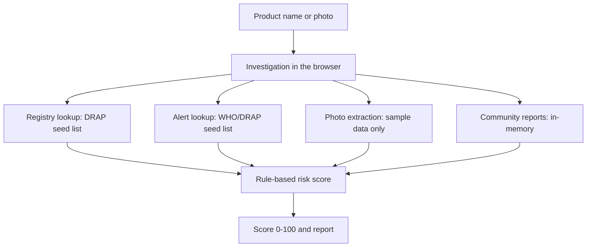

# Asal ya Nakli (اصل یا نقلی)

> Checks whether a medicine looks genuine by matching it against a registry list and safety alerts, then scoring the risk with fixed rules, because counterfeit-medicine warnings are hard for buyers to find at the counter.

**Status:** Client-side prototype, built in one evening (first commits 2026-08-14) · uses small hand-written seed lists, not live DRAP or WHO data · no working photo OCR
**Demo:** [asal-ya-nakli.web.app](https://asal-ya-nakli.web.app) (static site on Firebase Hosting; everything runs in your browser)

---

## What it does

You type a medicine name (or upload a photo) and the app returns a 0-100 authenticity score with a breakdown.



- Risk scoring is deterministic rules with the result clamped to 0-100 (`src/lib/risk/engine.ts`).
- Registry data is `DRAP_REGISTRY_SEED` in `src/lib/providers/drap.ts`. Alert data is in `src/lib/providers/who.ts`. Both are hand-written samples with a few entries; nothing is fetched from DRAP or WHO.
- The deployed app is a static export (`output: "export"` in `next.config.ts`). The API routes under `src/app/api/` are stubs; when `/api/investigate` does not return a result, `src/app/page.tsx` runs the investigation in the browser.

## Quickstart

Requires Node.js 18.18 or newer.

```bash
git clone https://github.com/HamzaKhanBUIC/asal-ya-nakli.git
cd asal-ya-nakli
npm install
npm run dev
```

Open http://localhost:3000. Other scripts: `npm run build` (static export to `out/`), `npm run lint`.

## Configuration

No environment variables are needed for the demo behaviour. The code reads these optional ones:

| Variable | Read in | Effect |
| :-- | :-- | :-- |
| `GROQ_API_KEY` | `src/lib/groq/client.ts` | Enables the Groq call for photo extraction (see Limitations) |
| `NEXT_PUBLIC_SUPABASE_URL` | `src/lib/supabase/client.ts` | Supabase project URL |
| `NEXT_PUBLIC_SUPABASE_ANON_KEY` | `src/lib/supabase/client.ts` | Supabase anonymous key |
| `SUPABASE_SERVICE_ROLE_KEY` | `src/lib/supabase/client.ts` | Server-side Supabase key |

`supabase/schema.sql` defines the tables for the optional Supabase store. The deployed demo has no Supabase configuration and keeps data in browser memory only.

## Limitations

- **Photo OCR does not work.** `extractProductFromImage` in `src/lib/groq/client.ts` returns a hard-coded "Panadol 500mg, registration 001234, batch B8921" result when there is no Groq key or when the call fails, and merges those values into partial results. Any photo can therefore come back as Panadol. When a key is set, the request goes to `llama-3.3-70b-versatile`, which is a text model and not a vision model. On the deployed site no key exists, so photo input is always this sample result. Do not use it to judge a real medicine.
- **Data is a seed list, not DRAP or WHO.** Only the sample products and alerts in `src/lib/providers/` can match.
- **Community reports are not shared.** The report endpoint is a no-op stub; reports stay in your browser's memory and are lost on reload.
- **Shareable links** only work for the pre-rendered `/investigation/AYN-DEMO` page.
- **No rate limiting.** `src/lib/rateLimit.ts` exists but nothing imports it.
- **Supabase policy is open for writes.** `supabase/schema.sql` lets anonymous users insert rows (`WITH CHECK (true)`). Tighten it before deploying a real project.
- **No tests.** `scratch/test-full-suite.js` expects a server on `localhost:3000`, which a static export does not provide, and two of its checks cannot pass against the current stubs. The earlier "6 passed" output was removed because it cannot be reproduced.
- `next.config.ts` sets `typescript.ignoreBuildErrors` and `eslint.ignoreDuringBuilds`.
- This is not medical or regulatory advice.

## License

No license file is included yet, so all rights are reserved by the author until one is added.
