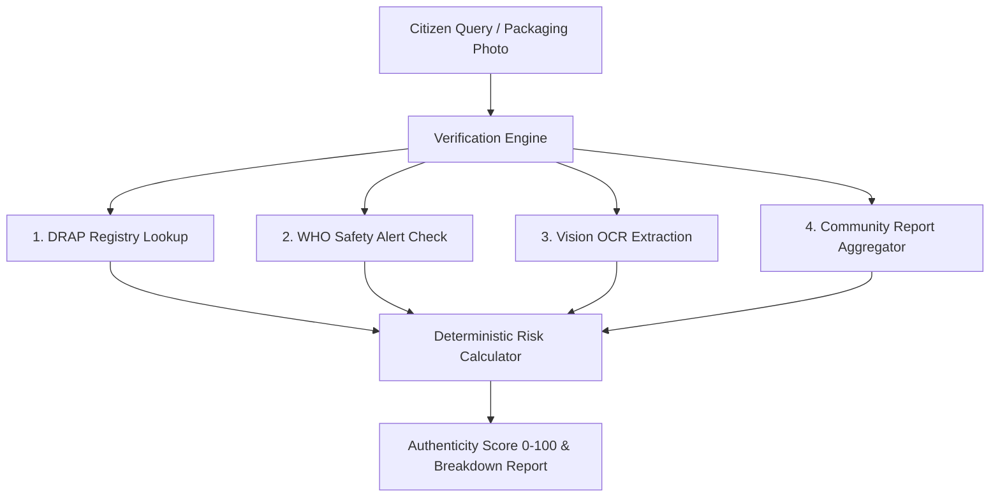

# Asal ya Nakli (اصل یا نقلی)

> Evidence-based medicine authenticity and regulatory verification platform combining DRAP registries, WHO safety alerts, and multimodal vision OCR.

[](https://asal-ya-nakli.web.app)
[](https://github.com/HamzaKhanBUIC/asal-ya-nakli)
[](https://nextjs.org/)
[](https://supabase.com/)

---

## Overview

Falsified and substandard pharmaceuticals pose a significant public health hazard in developing healthcare markets. Regulatory warnings issued by public authorities often remain trapped in static PDF circulars that are difficult for consumers to cross-reference at point-of-sale.

**Asal ya Nakli** is an open verification platform that evaluates pharmaceutical product authenticity by correlating four independent verification vectors:
1. **Regulatory Registry Lookups**: Cross-references active registration numbers and authorized manufacturers against Drug Regulatory Authority of Pakistan (DRAP) datasets.
2. **Global Health Alerts**: Checks against World Health Organization (WHO) Medical Product Alerts for known counterfeit batch signatures.
3. **Multimodal Vision OCR**: Uses vision models to extract batch numbers, manufacturing dates, and registration strings from medicine box photos.
4. **Community Incident Reports**: Aggregates localized reports tagged by pharmacy and geographic location.

---

## System Architecture



---

## Core Capabilities

- **Deterministic Risk Scoring**: Prevents generative hallucination of safety scores through a bounded rule matrix incorporating official registry status, alert matches, and batch consistency.
- **Multimodal OCR Extraction**: Automatically extracts dosage, registration number, and batch codes from user-submitted packaging photos.
- **Sanitized Prompt Boundaries**: User text and OCR extractions are encapsulated in structured boundaries to mitigate prompt injection risks.
- **Sliding-Window Rate Limiting**: Protects backend verification endpoints from automated request scraping.

---

## Verification & Test Suite

The repository includes an automated 6-point verification suite (`scratch/test-full-suite.js`):

```text
====================================================
 ASAL YA NAKLI : COMPREHENSIVE VERIFICATION SUITE
====================================================

[TEST 1] Authentic Product Search ("Panadol 500mg").......... PASSED (DRAP Reg #001234)
[TEST 2] WHO Safety Alert Corroboration ("Augmentin 625mg").... PASSED (WHO Alert N9/2025)
[TEST 3] Vision OCR Analysis (Base64 Photo)................... PASSED (Batch Extracted)
[TEST 4] Community Reporting ("Panadol 500mg")................ PASSED (Report ID Logged)
[TEST 5] Shareable Record Link Retrieval..................... PASSED (Record Retrieved)
[TEST 6] Recent Community Reports Feed...................... PASSED (Feed Retrieved)

====================================================
 TEST SUMMARY: 6 PASSED | 0 FAILED (100% PASS RATE)
====================================================
```

---

## Tech Stack

| Layer | Technology |
| :--- | :--- |
| **Frontend** | Next.js 15 (App Router, Server and Client Components) |
| **Styling** | Tailwind CSS |
| **Database** | Supabase Cloud PostgreSQL with Row-Level Security (RLS) |
| **Vision OCR** | Groq Server-Side API (`llama-3.3-70b-versatile`) |
| **Hosting** | Firebase Cloud Hosting |

---

## Local Setup

### Prerequisites
- Node.js 18 or higher
- npm 9 or higher

### Installation

1. **Clone the repository**:
   ```bash
   git clone https://github.com/HamzaKhanBUIC/asal-ya-nakli.git
   cd asal-ya-nakli
   npm install
   ```

2. **Configure environment variables**:
   Create `.env.local` in the project root:
   ```env
   GROQ_API_KEY=your_groq_api_key
   NEXT_PUBLIC_SUPABASE_URL=https://your-supabase-project.supabase.co
   NEXT_PUBLIC_SUPABASE_ANON_KEY=your_supabase_anon_key
   ```

3. **Start development server**:
   ```bash
   npm run dev
   ```
   Open `http://localhost:3000` in your browser.

4. **Run verification suite**:
   ```bash
   node scratch/test-full-suite.js
   ```

---

## License & Attribution

Open-source under the MIT License. Developed with reference to public drug regulatory standards and WHO Global Surveillance guidance.
